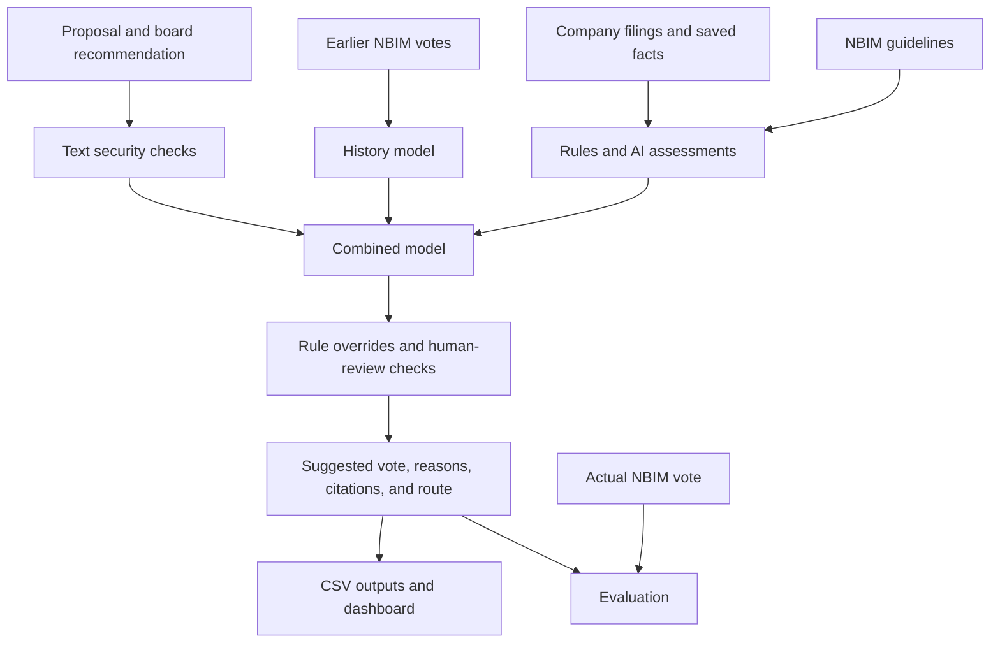

# NBIM voting agent — Case 1

The agent suggests FOR, MOT, or AVSTÅ for NBIM voting proposals and identifies
cases requiring human review. It combines earlier votes, company evidence,
voting guidelines, and saved model assessments. It never submits votes.

## Run the application

Use Python 3.10 or newer and run commands from this repository. The source
reads the supplied evidence snapshots directly; package installation is unnecessary.

```bash
python3 -m venv .venv
source .venv/bin/activate
python -m pip install -r requirements.txt
python run.py predict
python run.py dashboard
```

The prediction engine uses only Python's standard library and needs no
installation. A saved replay needs
no API key or internet connection. The year remains fixed at 2026.

The dashboard keeps its Norwegian interface. Filter and sort the proposals, inspect reasons and supporting
documents, navigate proposals, or download the selection. “Vis fasit” displays
NBIM's recorded vote for comparison.

## Generated outputs

The prediction command prints compact MOT-quality and review-routing tables,
then creates these files under `data/outputs/`. It generates no Markdown reports:

| File | Contents |
|---|---|
| `decisions_2026.csv` | 1,539 general proposals. |
| `dashboard/predictions_main.csv` | General proposals in the dashboard schema. |

Outputs are ignored by Git. Regenerate them after changing inputs. Use
`python run.py predict --output-dir /tmp/nbim-results` for an isolated run.

“Against the board” differs from literal MOT when the board recommends MOT.
The dashboard counts literal MOT as the positive class.

## What the solution predicts

The primary modeling target is **whether NBIM votes against the board**.
This differs from predicting the ballot label `MOT`:

| Board recommends | Follow the board | Oppose the board |
|---|---|---|
| `FOR` | `FOR` | `MOT` |
| `MOT` | `MOT` | `FOR` |

For example, a shareholder proposal to declassify a board can receive a
board recommendation of `MOT`. NBIM's guideline supports declassification,
so the agent can suggest `FOR`. That is an against-the-board suggestion.

The pipeline translates the direction into a ballot vote after scoring and
rule checks. For some country/proposal-type combinations, it uses `AVSTÅ`
when earlier NBIM against-the-board votes were mostly abstentions, with at
least two earlier examples. This is a historical convention, not a separate
three-class probability model.

## How a proposal moves through the solution

The pipeline reads the saved evidence, scores each eligible proposal, applies
rules and review checks, and writes an explanation alongside the suggested
vote. The diagram summarizes that flow:



Security flags remain review requirements throughout this flow. Scoring
continues so the reviewer can see the suggestion and its supporting context.

### 1. Read the data and keep the answer separate

The main dataset is
[`data/raw/real_votes.csv`](data/raw/real_votes.csv). The history model
uses rows with a known board comparison and a known NBIM vote. Proposal
metadata includes the meeting, company, date, title, proposal type, country,
proponent, and board recommendation.

A proposal title often doesn't explain the underlying governance or pay
issue. The pipeline therefore supplements it with saved company evidence:
US SEC proxy statements and role data, plus exported Japan EDINET and Korean
OpenDART facts from the team's Jev pipeline. A proxy statement is the company
document describing what shareholders will vote on.

The policy sources are the
[structured 2025 voting guidelines](data/policy/guidelines_2025.json)
and [NBIM position papers](data/policy/position_papers.json). `GVG` in a
citation means Global Voting Guidelines.

Current-row `nbim_vote`, `nbim_vote_raw`, `against_board`, `rationale_text`,
`rationale_section`, and `position_paper` are answer or explanation fields.
They must not become decision inputs. Earlier NBIM outcomes are legitimate
history; the current outcome is used for labels and evaluation. The final
CSV includes actual votes so you can compare predictions with outcomes.

### 2. Build a historical score

[`src/models/history.py`](src/models/history.py) fits a logistic regression,
a model that learns weights for a small set of inputs and returns a
probability. Its eight inputs describe:

- NBIM's opposition rate for the proposal type.
- How that rate differs in the proposal's country.
- NBIM's voting history at the company.
- The history of that proposal type at the company.
- The history of the same proposal wording across companies.
- Whether NBIM opposed the same item at this company last time.
- Whether NBIM supported it last time.
- Whether the company has no earlier meetings in the data.

Rates with few examples are pulled toward broader averages. Features use
only votes from earlier dates, and proposals on the same date cannot see
each other's outcomes. For a test year, the history model freezes its
history before January 1 of that year.

For 2026, the history model fits on years before 2026. It chooses its upper
opposition threshold using the preceding year's validation scores rather
than the test year's answers.

### 3. Apply NBIM's rules to the evidence

The rule modules turn specific policy conditions into traceable signals.
They complement the historical score where a title or company fact gives a
clear policy reason.

For **US director elections**, an AI reader extracts board independence,
nominee roles, committee membership, attendance, other board seats, and
related facts. It receives document passages and factual questions, without
NBIM's votes or voting rules. Supporting quotes are checked against the
source text before rules rely on them. SEC role data provides an additional
source for some director facts.

[`src/rules/board.py`](src/rules/board.py) then applies rules in
Python, such as an executive sitting on the audit committee or a nominee
holding too many board seats. A director signal must earn trust before it
can trigger an automatic opposition suggestion: NBIM must have followed it
at its last two applicable earlier meetings. At each such meeting, following
the signal means opposing at least half the nominees it flagged. A miss
removes that trust. Untrusted signals still reach the reviewer with their
facts and quotes.

For **proposals identifiable from their wording**,
[`src/rules/policy.py`](src/rules/policy.py) recognizes cases
such as declassifying the board, written consent, proxy access, takeover
defenses, and unspecified “other business.” It maps the policy's ballot
position to agreement or disagreement with management. These rules have a
separate drift monitor that suspends a rule after NBIM goes the other way
on its last two cases.

For **Japan and Korea director elections**,
[`src/rules/policy.py`](src/rules/policy.py) uses exported role
and board-independence facts as reasons for review. These signals don't
justify an automatic opposition suggestion on their own.

[`src/rules/policy.py`](src/rules/policy.py) compares the stored
policy with a saved copy of NBIM's guidelines webpage. Rules whose wording
has softened are held for review. A normal replay uses the saved webpage;
it doesn't check the current website.

### 4. Combine the available assessments

[`src/models/combined.py`](src/models/combined.py) produces the
score used for the general vote file. For proposals without a usable US
director-judge answer, it combines seven inputs:

- The historical model's probability.
- A second model's probability, exported from the team's pipeline.
- Jev's probability, also exported from that pipeline.
- Whether Jev recommends opposing the board.
- Whether a director-rule signal applies.
- Whether a director-rule signal has earned trust.
- Whether a proposal-wording rule applies.

The exported second model uses gradient boosting on voting history and
company facts. Jev assesses the proposal using guidelines, earlier company
votes, and available company facts. Their saved probabilities describe
`MOT`, so the combined model reverses them where the board recommends `MOT`
to express opposition to the board consistently.

For US director nominees with a cached **judge** assessment and enough
training examples, a separate, smaller regression combines only the history
score and the judge's probability. The judge weighs extracted facts against
NBIM's rules and earlier practice without company or nominee names. If
there aren't enough judged training examples, the shared model is used.

The combination weights and upper opposition threshold come from earlier
years. The 2026 combination uses saved component years 2021–2025. If a
proposal has no exported components, the runner retains the history score
and still applies the available rule and review checks.

### 5. Decide who must review the suggestion

A score first assigns a probability band. The model uses a lower level
of 5% and learns its upper threshold from earlier data.

| Initial score | Band | Suggested direction |
|---|---|---|
| Below 5% | `likely WITH board` | Follow the board. |
| From 5% to below the learned upper threshold | `send to human` | Keep the board's vote as a provisional suggestion and require review. |
| At or above the learned upper threshold | `likely AGAINST board` | Oppose the board, subject to the checks below. |

A trusted, applicable rule can override the initial band toward opposition.
A human-review flag can prevent an automatic decision regardless of the
score. Review reasons include:

- Instruction-like or unfamiliar ballot wording, or a proxy addressing an
  automated reader.
- No earlier votes at a company, unless an active rule supplies the basis
  for an opposition suggestion.
- An absent board recommendation where passed to the decision function.
- An applicable rule that is untrusted, suspended, or softened in the saved
  policy comparison.
- A general-model opposition suggestion without an applicable rule or NBIM's earlier opposition to the same item.
- A Japan/Korea fact that warrants review.

`band` records the model/rule direction; `decided_by` records whether the
suggestion cleared the review checks. A row can be `likely WITH board` and
still require `human review`. Always inspect `review_reason`.

### 6. Attach the explanation and evaluate

Each decision includes contributing facts or historical signals, a guideline
reference where available, the guideline's wording and page reference, and
an evidence URL where available. Citation selection can come from a fired
rule, a saved guideline assessment, Jev, or an earlier pattern of NBIM
rationales for that proposal type. A citation selected from history is
context for review; it does not prove that the rule's conditions hold.

Position papers add policy context to citations. They are not an additional
probability input to the deployed models. Where no numbered guideline is
cited and the suggestion follows the board, the dashboard export displays
NBIM's general voting principle `P.1`.

## Refresh evidence

Refresh commands are explicit: they can download data, update evidence, and
incur hosted-model charges. They do not run during prediction or dashboard use.
The original vote file and imported general Jev scores remain supplied inputs;
this checkout does not implement a new-agenda workflow or the upstream models.

Rebuild SEC evidence in this order:

```bash
python run.py refresh director-roles
```

SEC requests use the contact User-Agent in
`src/evidence/http.py`. Configure your contact information there before
collecting new evidence.

Hosted-model refreshes read `OPENROUTER_API_KEY` from `.env`, falling back to
the environment. Copy `.env.example` to `.env` and set your own key.
After the required SEC evidence exists, use:

```bash
python run.py refresh board-facts --limit 8
python run.py refresh judge --through-year 2026
python run.py refresh rule-checks
```

The board reader verifies quoted passages from company proxies.
Saved responses live in `data/evidence/assessments/` and are required for replay.
Missing responses retain their existing model-specific fallback behavior;
prediction never fills them by making a network request.

Use `refresh guidelines` to download a new policy comparison and
`refresh position-papers` to refresh position papers. Review policy changes
before regenerating predictions because they can change rule routing.

## Repository structure

The `src/` folder has three domain folders: `models/` fits and scores, `rules/`
applies voting policies and review gates, and `evidence/` collects and interprets
source material. `pipeline.py` assembles decisions, `outputs.py` writes CSV decisions
and dashboard exports, and `dashboard.py` presents them. `data.py` holds data
locations, decision records, and saved-assessment storage. `run.py` is the entrypoint.

`data/raw/` holds the source vote dataset; `data/policy/` holds policy;
`data/evidence/` holds company facts and saved assessments. Imported Jev
scores, facts, and document links are described in the
[upstream provenance notes](data/evidence/jev_pipeline/README.md).

Each prediction invocation owns its memoized fits and assessment lookups.
Shared metrics and numerical fitting have one implementation. Model-specific
probability clamps and the two director trust policies remain explicit.

## Verification

The tests check model chronology, label isolation, quote verification,
security flags, rule trust, overlap matching, routing, exports, and complete
output parity with the pre-refactor implementation. Integration tests generate
their outputs in temporary directories and block network access.

```bash
python -m unittest discover -s tests
ruff check run.py src tests
ruff format --check run.py src tests
vulture run.py src tests --min-confidence 100
```

The dashboard tests need the dependencies in `requirements.txt`. Outputs do not
need to be committed or prepared before running tests.

## Practical limits and provenance

This is historical decision support. The 2025 guideline edition is used across
historical years; company coverage varies. US board evidence comes from SEC
roles and proxy readings, while Japan/Korea facts and general Jev scores come
from the team's separate `marie` branch. Quote verification confirms that words
occur in the source, not that the company's statement is true.

Training uses earlier years, but 2026 was viewed repeatedly during development.
Some upstream models and wording patterns were developed with that year visible.
Results are development evidence, not a fully untouched external test.
Security checks and review routing still have false alarms and missed cases.

The dashboard was built by Marie and adapted to this branch. Saved assessments
use Microsoft Decision-1, Typesafe Jev, and Claude Haiku through OpenRouter;
these identifiers describe saved runs and do not guarantee future availability.
Claude Code and Codex assisted implementation, research, evaluation, and docs.
The Git history retains removed research and original hackathon material.
