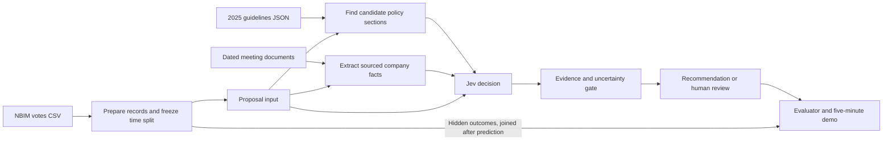

# Proposed Case 1 architecture

**Assumptions:** use [NBIM API votes](data/real_votes.csv) as the answer key, [your structured 2025 guidelines](startpakke/case1_stemmegivning/retningslinjer_2025.json) as the policy source, and Jev for a typed decision. The product **recommends and explains** a vote; uncertain cases go to a person. I would use plain section lookup and a local document cache first—no vector database.

Two pieces already exist: [a statistical benchmark](benchmark/model.py) and [a DEF 14A downloader](startpakke/case1_stemmegivning/hent_def14a.py). The benchmark predicts **disagreement with management**, while the case’s primary metric is **NBIM voting MOT**. Those targets overlap but are not identical. The downloader currently expects the N-PX CSV format, so it needs adapting before use with `real_votes.csv`.

### 1. Agree on three records before dividing work

This is the interface between teammates. Use **`meeting_id` + `item_no`** as the stable proposal key.

| Record | Fields that matter |
|---|---|
| **Proposal input** | Key, meeting date, company, country/market, proposal text, proponent, management recommendation |
| **Evidence** | Candidate guideline ID, exact policy text and PDF page; relevant company fact, source URL, publication date and excerpt; missing facts |
| **Decision** | Key, FOR/MOT/AVSTÅ recommendation, Jev probabilities, cited rule and facts, `automatic` or `human review`, review reason, elapsed time |

Keep `nbim_vote`, `against_board`, `rationale_text`, `rationale_section`, and `position_paper` **outside** those records. The evaluator joins them in afterward.

### 2. Modules and team ownership

| Owner | Module and work | Verification before integration |
|---|---|---|
| **Data + evaluation** | Load and validate votes; make a meeting-level chronological split; implement “follow `mgmt_rec`” and “always FOR” baselines. Own the evaluator. | Fixed eligible-row counts and hand-checked confusion matrix. |
| **Policy** | Load the 76 rules from the JSON; map proposal wording to a small set of candidate sections; return exact text, ID, page and [PDF URL](https://www.nbim.no/contentassets/01a7ee19b5d84a73a67a365e76a0fb01/global-voting-guildeines_2025.pdf). | Every returned citation exists in the JSON and PDF. Test retrieval against historical `rationale_section` **after** prediction. |
| **Company evidence** | For selected rule types, obtain meeting documents dated before the vote and extract only the needed facts with source excerpts. Cache per meeting. | Every fact has a source and a publication date no later than the meeting. Missing facts remain explicitly missing. |
| **Jev + decision** | Send proposal, management recommendation, candidate policy and sourced facts to Jev; implement the review gate and result log. | One typed result per proposal; no label fields in the request; reproducible behavior on saved examples. |
| **Integration + demo** | Run the end-to-end command, show an agenda with recommendation/citation/review status, prepare the one-page response and resistance test. | Another teammate can reproduce the principal metric with one command. |

With three people, combine **data + integration**, **policy + evidence**, and **Jev + decision**.

### 3. Decision path

1. Start with the proposal and `mgmt_rec`. A simple text lookup selects **one to three** relevant guideline sections. If it cannot find a plausible section, record that.
2. Fetch company facts **only when the candidate rule needs them**. For example, a board-independence rule needs evidence about the board; the title “Elect Director X” does not supply that fact. The existing DEF 14A downloader can help with a US subset after adapting its input fields. For other markets, use dated company meeting materials.
3. Give Jev a bounded **FOR / MOT / AVSTÅ** `Choice` question using that evidence. It can return class probabilities; a separate evidence-sufficiency question can go in the same request about the same proposal. [TypeSafe Choice documentation](https://docs.typesafe.ai/primitives/choice)
4. Apply ordinary code rules: **missing required fact, invalid citation, conflicting evidence, or insufficiently convincing probability → human review**. Show the management recommendation as the baseline, but label it as such when the system cannot justify its own vote. Use the probability of **MOT**, not Jev’s general confidence alone, to set a MOT threshold. Choose thresholds on validation data. [TypeSafe confidence documentation](https://docs.typesafe.ai/confidence)

The explanation can be assembled from the selected rule and sourced fact. A generative LLM is useful for extracting facts from a complex document; it need not run for every proposal.

### 4. Benchmark protocol

**Freeze the split before tuning.** A practical plan is 2025 for development and threshold selection, then 2026 for final evaluation. Confirm that the 2025 guideline version was applicable to each evaluated meeting; use older votes for the statistical history model, but do not claim a 2025 rule predicted a vote made years before it existed.

On the **1,539 eligible 2026 rows**, following management gets **8 of 66 MOT votes**: **57.1% MOT precision, 12.1% MOT recall**, and **95.7% overall agreement**. That is the main baseline to beat. There are **58** 2026 cases where management recommended FOR and NBIM chose MOT. [Source data](data/real_votes.csv)

Report these for **every** method on the same eligible test rows:

- **Primary:** MOT precision, recall, F1, true MOT hits, false MOT alarms, and missed MOT votes.
- **Business value:** how many management-FOR/NBIM-MOT cases were found.
- **Human workload:** automatic coverage, review count, and how many real MOT cases entered review. Count a review as *not automatically caught* in automatic MOT recall; show review-assisted recall separately.
- **Explanation quality:** fraction of recommendations with a valid policy citation and sourced required facts.
- **Operation:** median and slow-end latency, number of model calls, and the result of the required instruction-in-proposal resistance test.

Keep the existing statistical model as a **comparison or proposal-priority signal**. Its present `against_board` score cannot be reported as MOT precision/recall without evaluating it against `nbim_vote == "MOT"`. Its exported CSV also contains the actual answer, so it belongs only in evaluation, never in a Jev request.

### 5. Build order

1. **First vertical slice:** one clean proposal → policy section → Jev result → citation or review → evaluator join. Verify the answer fields never reach Jev.
2. **Baselines and split:** print the 2025/2026 counts and management baseline from one command.
3. **Evidence scope:** begin with proposal types whose decision can be supported from available text; add a small, dated document-backed subset. Evaluate and disclose coverage for the whole chosen scope.
4. **Timed pilot:** run about 100 representative proposals, measure latency and costs, then run the frozen holdout with cached sources.
5. **Delivery:** five-minute demo, reproducible code/README, one-page response with numbers, limits and next steps. The judging rules weight problem understanding and evaluation at **30% each**, followed by explanation and robustness at **20% each**. [Judging rules](startpakke/Regler_og_bedommingskriterier.pdf)

The first team decision should be **which proposal types you can substantiate with pre-meeting evidence**. That choice controls the document work, Jev calls, and the coverage you can honestly claim.
