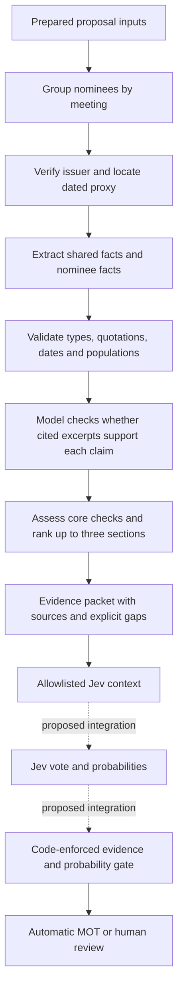

# How director evidence reaches a Jev decision

The evidence pipeline builds a sourced research brief for one director election.
It tells the decision module what the documents establish, which NBIM rules
might matter, and which questions remain unanswered. It does not call Jev or
produce a final vote.

> **Note:** This is a preview feature currently under active development.

Use this explanation to understand the implementation and plan its next steps.
For command options and runnable examples, see the
[director evidence reference](reference/director-evidence.md). The broader team
responsibilities remain in the [Case 1 architecture](case1-architecture.md).

## Current scope and responsibilities

The callable collector supports United States companies in developed markets,
`DIRECTOR_ELECTION` proposals, and meeting years 2025 and 2026. Both years use
an explicitly fixed version of the supplied 2025 policy. This does not establish
that the 2025 policy was the applicable policy at every evaluated meeting.

| Module | Responsibility |
|---|---|
| [`records.py`](../src/records.py) | Define shared records, allowlist proposal fields, and assemble decision context. |
| [`evidence.py`](../src/evidence.py) | Verify SEC sources, extract facts, check supporting excerpts, cache results, and run batches. |
| [`policy.py`](../src/policy.py) | Look up exact policy text, assess core concern signals, and rank candidate sections. |
| Future decision module | Call Jev, validate its response, enforce the review gate, and record the recommendation. |
| Future evaluator | Join actual NBIM votes after prediction and measure decisions, coverage, and workload. |

OpenRouter performs extraction and a separate source-support check. Jev is the
planned voting model. They have different jobs: an extractor describes the
company; Jev applies the policy to those descriptions.

The shared key is `meeting_id` plus `item_no`. Company facts can be shared across
nominees at one meeting, but each proposal gets its own packet. N-PX meeting
identifiers are not interchangeable with these NBIM proposal keys.

## The flow in plain language

The pipeline first collects evidence, then chooses the most relevant policy
sections. This order lets a disclosed chair/CEO combination affect selection.



A missing fact stays missing. Failure to discover a problem does not establish
that no problem exists. The v1 handoff therefore prohibits automatic FOR votes.

## 1. Start from label-free proposals

`proposal_input()` copies only the approved input columns. These include the
meeting/item keys, company identity, ticker, country, market, date, proposal
number/text/type, proponent, and management recommendation (`mgmt_rec`). IDs stay
strings, and the date must parse as an ISO calendar date.

The proposal record excludes `nbim_vote`, `nbim_vote_raw`, `against_board`,
`rationale_text`, `rationale_section`, and `position_paper`. Those fields reveal
the answer or NBIM's explanation. The current decision context also excludes
historical voting examples and benchmark predictions.

The command selects the requested year, country, type, and optional meeting.
It rejects duplicate keys and empty selections. `--item-no` selects the output
item, while extraction still uses the other input rows for that meeting so a
single-item request can reuse the meeting's extraction cache.

The command filters out other countries/types. The callable collector instead
returns explicit unsupported-scope results when called with such proposals.
Coverage reports must make this denominator distinction visible.

## 2. Verify the issuer and meeting document

`collect_meeting_evidence()` requires all input proposals to have the same
meeting ID, company ID, and meeting date. It then resolves the SEC company
identifier, or CIK, and finds a matching definitive proxy.

Issuer matching uses an exact normalized company name, removing punctuation
and common company suffixes. A unique ticker match is not enough. The supplied
Blackbaud ticker, for example, points to BlackRock; trusting that ticker alone
would retrieve another issuer's evidence. The resolved issuer must also match
a current or former name in SEC submissions metadata.

A reviewed override can map a company ID to a CIK. It must include the company
name, source URL, and reviewer. Overrides still undergo the submissions-name
check. The field requirements document review provenance; code cannot establish
that a human actually performed the review.

The document selector considers `DEF 14A` filings from the 120 days strictly
before the meeting. Same-day filings are excluded because the input contains
no voting timestamp. The collector searches recent and relevant archived SEC
submission batches and considers candidates newest first.

`_meeting_proxy()` accepts a filing only when its opening text associates the
intended date with an annual or special meeting notice. A filing date or SEC
`reportDate` alone is not meeting proof. It then checks full nominee names in
the text; a later sourced `on_ballot` fact must establish current nomination.
A former director merely mentioned in a biography cannot qualify on name
presence alone.

The date/name rules are conservative text heuristics, not a universal proxy
parser. Unfamiliar date formats, name variants, or notice wording can create
false gaps. A material wrong-meeting result remains a serious failure to test.

## 3. Preserve source text and ask factual questions

`TextOnly` removes script/style and hidden XBRL content while retaining visible
paragraph, table-row, and cell separators. It does not reconstruct every HTML
table's visual meaning. The canonical text is the coordinate system used for
quotation offsets; positions are not raw HTML byte offsets or PDF pages.

`relevant_text()` keeps opening material and windows around nominee names and
governance terms. It merges overlapping windows and caps the supplied context
at 100,000 characters. Content outside those windows or after the cap cannot
support that extraction request, even if it exists elsewhere in the filing.
This is one reason a clearly disclosed role can still remain unknown.

The collector sends one batch of meeting-wide questions and batches of up to
five nominees. Prefixes such as `meeting:board_total` and `1:ceo` identify where
answers belong; `1` in that example is the proposal's item number.

| Fact group | Questions |
|---|---|
| Shared company facts | Cap classification, majority voting control, proposed-board independent/total counts, and current audit-committee independent/total counts. |
| Nominee roles | Current election slate, independence, executive status, audit/remuneration membership, nomination-committee chair, board chair, CEO, and founder status. |
| Outside commitments | Minimum proven current corporate board and board-chair counts, including this issuer. |

The model receives source material as untrusted data and is instructed to
ignore embedded commands. It must return typed values, statuses, quotations,
population/time descriptions, and reasons using structured output. Schema
requests constrain formatting; local validation is still necessary.

## 4. Validate facts before treating them as known

There are two different checks: whether words occur in the document, and
whether those words establish the requested fact.

`checked_facts()` validates primitive types and source provenance. Counts must
be nonnegative integers, not booleans. Roles use booleans. Company size is
`large`, `mid`, or `small`; SEC reporting status is not substituted for a cap
classification.

Quotation matching tolerates whitespace and escaped line breaks, then stores
the exact matched canonical text with offsets. Unmatched quotations are
excluded. If other valid quotations remain, those may still support the claim
after the separate support check. Nominee-specific facts need a full-name link.
For role counts, a nearby nominee heading can be included in the cited span
before support verification.

Every source entry includes its URL, filing date, raw-document SHA-256 hash,
quotation, and canonical-text start/end offsets. A sourced fact must come from
a filing dated before the meeting. Matching quotations initially produce
`partial` facts; they do not immediately become `known`.

`verify_support()` asks the configured model a second question: do this claim's
own quotations directly establish its value for the person, population, and
time? This response must be a boolean verdict, not another answer to the
original fact question. A positive verdict must cite material contained in the
claim's original excerpts. The code also blocks promotion of negative roles
without an explicit negative expression, and zero role-count lower bounds are
left partial as uninformative.

Both calls use the configured extraction model. This is a separate pass, not
independent human verification or agreement between different model providers.
The model can repeat its own mistake. The negative-expression check is also a
heuristic: an unrelated negation can occur in a long excerpt, and legitimate
negative facts may use wording that it misses.

| Fact status | Interpretation |
|---|---|
| `known` | Passed local provenance/type checks and the model support check; still subject to audit. |
| `partial` | Useful sourced material exists, but support, completeness, or certainty is insufficient. |
| `unknown` | No accepted factual answer is available. This never means false. |
| `conflicting` | Count or population consistency checks failed, or contradictory material was retained. |

Count checks reject zero denominators and independent counts above the total.
They also currently compare free-text `scope` strings literally. Descriptions
such as "proposed board" and "proposed board of twelve nominees" can therefore
create a conflict even when they refer to the same population. That known
implementation flaw is conservative but reduces usable evidence. It is not
proof that the underlying documents disagree.

## 5. Select policy and express readiness

`select_policy()` indexes the supplied JSON's 76 rules and finds 25 potentially
applicable US director-election rules. Derived proposal-type/market tags help
filter them; those tags are not quoted NBIM policy. The output preserves exact
rule text, IDs, PDF pages/URL, subsection introductions, and principles.

The current executable checks cover eight rules across four sections:

| Section | Implemented concern checks |
|---|---|
| `1.1` | Board independence under the relevant size/control conditions (`1.1.1–1.1.3`). |
| `1.2` | Executives on audit/remuneration committees and audit-committee independence (`1.2.1–1.2.3`). |
| `1.3` | Combined board-chair/CEO roles, with unresolved founder exceptions kept for review (`1.3.1`). |
| `2.1` | More than five proven board roles or more than two proven board-chair roles (`2.1.1`). |

A known false prerequisite can rule out a concern without requiring unrelated
facts. For example, an independent nominee does not meet a rule targeting a
non-independent nominee. Current conflict checks run first, however, so an
unrelated population conflict can still block this short-circuit. That ordering
needs explicit review when rule assessment is improved.

Role counts are lower bounds. A proven minimum of six boards can establish a
numeric concern. A proven minimum of two does not establish that the actual
number is only two. The discretionary "too many other roles" branch remains
unassessed. Founder status alone does not establish whether a limited-period
exception and mitigating measures are satisfied; founder cases remain review
cases in v1.

Sections rank by concern signals, then unresolved core checks, then assessed
checks without concerns, then sections with only deferred checks. More concern
signals break ties, followed by numeric section order. At most three sections
are returned with full policy text. All 25 candidates retain coverage metadata,
including whether each was selected and why an omitted rule was omitted.

| Rule status | Interpretation |
|---|---|
| `ready` | The implemented check can assess its condition or rule it out from known prerequisites. |
| `incomplete` | Necessary evidence, an exception, or a discretionary judgment remains unresolved. |
| `conflicting` | A required fact is flagged as conflicting. |
| `not_applicable` | An implemented applicability check excludes the rule. |
| `not_implemented` | This evidence/check path has not been built. |

`concern` is separately true, false, or null. A ready check with `concern=false`
is not a justification for an overall FOR vote. A true concern with incomplete
status is not a fully supported MOT. An omitted rule is not a negative finding.

## 6. Package the result for the decision owner

`build_packet()` creates one JSON-serializable evidence packet per proposal.
`build_decision_context()` builds a detached dictionary for the future Jev
adapter, copying only approved proposal fields.

The context includes the proposal, fixed policy version, selected guidelines,
subsection introductions, principles, company/nominee evidence, all candidate
coverage, limitations, and a routing contract. That contract prohibits
automatic FOR and requires evidence, exception/conflict, and probability checks
before automatic MOT.

The routing contract is currently descriptive data. There is no Jev client or
code-enforced decision gate in this path. A future caller must not treat the
presence of a `routing_contract` dictionary as enforcement.

Management's recommendation is available as an input/baseline. The actual NBIM
vote is joined only in evaluation. An explanation must cite the supplied rule
and source excerpts; Jev's general knowledge cannot silently fill an unknown
company fact.

## Caches, outputs, and reproducibility

The collector uses local files so another teammate can reproduce evidence
without repeating paid model calls.

| Location or file | Contents |
|---|---|
| `data/evidence/_cache/sec/` | SEC ticker/submissions metadata and original filing bytes. |
| `data/evidence/_cache/core-model-v1/` | Raw fact-extraction answers. |
| `data/evidence/_cache/grounding-v2/` | Raw boolean support-verification answers. |
| `evidence.jsonl` in a run directory | One full packet per selected proposal. |
| `summary.json` and `report.txt` | Operational totals, evidence/check statuses, and failures. |

Model cache keys hash the schema version, document hash, and complete request,
including model, prompt, questions, and supplied text. Prompt or request changes
therefore invalidate relevant entries. Cache directory names are historical;
packet `schema_version` and policy version are separate concepts.

SEC resources are cached by their filenames and are not automatically refreshed.
Metadata may become stale, and metadata retrieval time is not yet recorded as
a structured snapshot field. Offline misses become explicit gaps. Sources or
credentials are not fetched in offline mode.

Retries are bounded. SEC calls are sequential with a delay before new requests;
model calls have timeouts and limited retries. Evidence failures generally
become proposal gaps. Missing input files and invalid CLI input stop the run.
A partially written output after an unexpected interruption still needs a fresh
output directory; the command does not resume or append packets.

The command uses exclusive creation for `evidence.jsonl`, so existing packets
are not overwritten. Shared facts repeat in each nominee packet. Summary fact
counts are per packet, not counts of distinct company facts. Ready-rule counts
are rule assessments, not automatic voting decisions. Cached replay's zero
cost/model-call totals describe replay activity, not the original extraction
bill. Cached timing is not a cold-run benchmark.

The [saved pilot artifacts](../data/evidence/pilot-v1/) contain the selected
inputs, manually annotated expectations, citation audit, accepted packets, and
an audit report. They are a reproducibility fixture, not a representative
voting-performance benchmark. The current checks can be run with:

```bash
python3 -m unittest discover -s tests -v
PYTHONPATH=src python3 -m unittest discover -s src/benchmark -p 'test_model.py'
```

## Proposed next steps for reliable Jev decisions

Complete these steps in order. Each step has a concrete acceptance check, and
later model confidence must never bypass earlier evidence requirements.

### 1. Fix population identity and rule applicability

Replace free-text scope equality with a structured population identity:
issuer, meeting, board versus committee, proposed versus current membership,
and effective date. Retain the human-readable scope description as explanation.
Do not simply delete the population consistency check; current-board and
proposed-board counts can genuinely differ.

Test equivalent descriptions, different populations, retiring/new directors,
zero totals, and inconsistent counts. Review conflict handling so a fact that
is irrelevant to an excluded rule does not unnecessarily block that rule.
Acceptance: equivalent populations no longer create false conflicts, while
real population mismatches remain blocked. Bump the record/schema version and
refresh affected fixtures when behavior changes.

### 2. Retrieve specific missing facts and exception evidence

Use the per-rule missing-fact lists to request targeted passages rather than
repeating broad extraction. Expand name matching carefully around documented
aliases and recover roles that are disclosed under shortened names. Record
context truncation explicitly and distinguish "not retrieved" from "not
present in the source."

For chair/CEO cases, capture founder status, the period of combined service,
and disclosed mitigating arrangements. When these require judgment, retain
review. Obtain a dated, agreed cap classification for size-dependent rules;
do not invent thresholds or substitute SEC filer categories. Keep SEC-only
scope until any new source path is deliberately approved and validated.

Acceptance: source-backed positive and negative examples exist for each core
rule family, including thresholds and exceptions. An adversarial irrelevant
quote, unsupported negative, or incomplete role list cannot qualify a finding.
Human annotations must measure both correctness and missing-fact coverage.

### 3. Tighten the evidence-to-decision contract

Represent the precise evidence supporting a rule branch, not just a flat list
of every possible requirement. For example, a confirmed minimum above the board
limit can establish that numeric branch without knowing every chair role.
Attach fact references to rule findings and define how relevant conflicts and
exceptions block each finding.

Validate response/context shapes at runtime. TypedDict annotations describe
records but do not validate incoming JSON. Include stable policy/prompt/model
versions, source hashes, and retrieval provenance in saved requests and results.

Acceptance: a decision owner can trace every material premise to accepted fact
references and valid sources. Extra fields, invented citations, wrong-proposal
facts, and unsupported evidence states cannot pass the contract.

### 4. Connect Jev with an explicit request and response

Adapt the typed MVP from `origin/marie` to the current records and paths. Send
only the allowlisted proposal, policy/context, accepted facts, and explicit
gaps. Preserve rules as authoritative instructions and filings/proposal text as
untrusted data. Keep historical-vote prompts separate from this evidence path.

Ask for FOR/MOT/AVSTÅ probabilities and evidence sufficiency. Define a strict
response record containing proposal key, selected vote, all probabilities,
rule/fact references, explanation, uncertainty, model version, and elapsed time.
Verify the provider's current interface before implementation; the MVP is a
starting point, not a frozen external API specification.

Acceptance: one result per input, including model failures; valid finite,
normalized probabilities; no answer fields in requests; and no citations outside
the supplied evidence. First test with a deterministic stub, then a small live
source-audited set containing supported concerns, cleared checks, and gaps.

### 5. Enforce review in code after Jev responds

Build the evidence gate as a pure decision step, separate from Jev and the
probability threshold. Permit automatic MOT only when the cited selected rule's
condition is supported, its necessary factual premises are known, sources and
citations are valid, relevant conflicts/exceptions are resolved, and the
validation-selected probability gate passes. Otherwise return human review.

Continue to prohibit automatic FOR under partial policy coverage. A suggested
FOR may be retained for analyst review, with management's recommendation shown
as a separately labelled baseline. `P.1` and a high confidence score cannot
supply missing company evidence.

Acceptance: table-driven tests cover every blocking reason. High model
confidence cannot override missing facts, an invalid citation, or a model
failure. The evaluator and demo must consume this route rather than recreate
a score-only approximation of it.

### 6. Evaluate the combined decision path honestly

Freeze the prompts, model configuration, retrieval, scope, and routing before
comparing decisions. Tune probability thresholds on development meetings only.
Join labels after prediction, and use the same eligible proposal rows for the
system and the follow-management baseline. Include retrieval failures and
review cases in the denominator.

Report MOT precision, recall, F1, false alarms, missed MOT cases, automatic
coverage, human-review workload, citation validity, factual correctness, and
latency/cost. Separate automatic recall from hypothetical review-assisted
recall. Add proposal/document instruction attacks, malicious fake rules,
wrong-person evidence, and conflicting-source tests.

The repository has already inspected 2026 outcomes. A further 2026 comparison
is retrospective unless a genuinely fresh evaluation set is reserved; calling
it a holdout does not restore its untouched status. The tiny selected source
pilot cannot establish precision, calibration, or operational coverage.

Acceptance: another teammate reproduces saved predictions, routes, and metrics
with one command. A useful deployment bar requires an explicitly agreed
precision/coverage tradeoff based on sufficient audited examples; it is not
established by the extraction pilot or by a generic model-confidence score.

### 7. Expand scope one verified rule/source path at a time

Add proposal types and countries behind the same record and source interfaces
only after each has policy-version coverage, dated evidence, annotated fixtures,
and review rules. Implement omitted director-election families deliberately,
including attendance, diversity, governance conduct, and sustainability concerns.

Acceptance: unsupported scope stays explicit, and adding one path does not
change established outputs for other paths without a documented version change.
